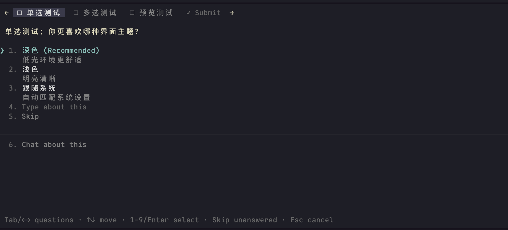
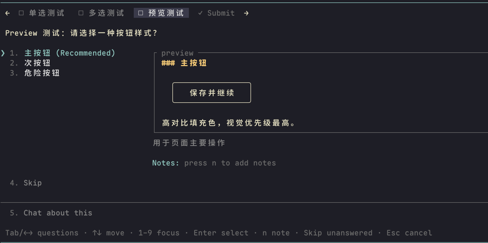
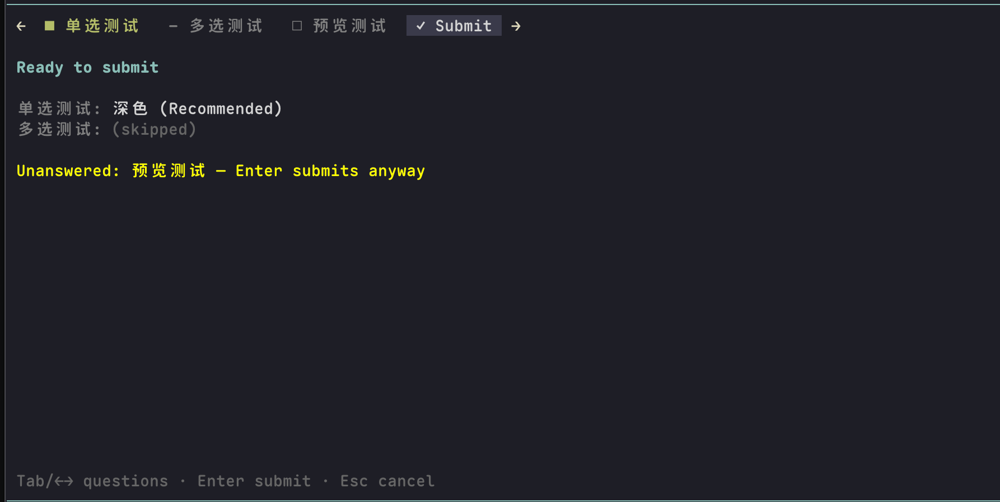

# pi-question

[English](README.md) | **简体中文**

一个 [Pi](https://www.npmjs.com/package/@earendil-works/pi-coding-agent) 扩展，为 LLM 提供 Claude Code 风格的 `ask_user_question` 工具：当模型遇到真正需要你拍板的决策时，弹出交互式选择界面，而不是自己瞎猜。

## 长什么样

| 单选 | 多选 |
| --- | --- |
|  | ![多选题：`[ ]` 勾选框，以及显式的 Next 确认按钮](public/multi-select.png) |
| **选项 preview** | **Submit 汇总页** |
|  |  |

## 功能

- **单问题**：带编号的选项列表——按 `1`-`9` 直接选中，或 `↑↓` + 回车；单选题选中即提交
- **多问题（最多 4 个）**：顶部短标签芯片栏（`■` 已答 / `–` 已跳过 / `✎` 仅备注 / `□` 未答），`Tab`/`←→` 切换，答完自动跳到下一个未答问题，最后有 **Submit** 汇总页——未答题可以跳过，在 Submit 上按 Enter 会提交已选部分
- **内置 "Type about this" 自由输入**：除带 preview 的题外，每题自带一行内联输入——光标移过去直接打字即可。支持多行（`Shift+Enter`）、粘贴，`Ctrl+G` 把草稿丢给你配置的外部编辑器。文本连同撤销历史按题保留；如果最终选了普通选项，打过的字会作为备注附带回传，不会被丢弃
- **可以附截图**：在任意输入框里按 `Ctrl+V` 粘贴剪贴板里的图片——图片落到临时文件、路径插进输入框，和 pi 主输入框的做法一致，所以把文件拖进终端同样算数。下方一行暗色的 `📎 shot.png` 作确认，把路径删掉就等于取消附件。提交后图片作为 image block 一起回传，正文会按顺序点名、说明每张图属于哪道题。尺寸按当前模型的图片上限缩放；模型不支持读图时不发，并明确告诉它有图没送出去
- **multiSelect 多选**：`Space`/`Enter` 切换 `[x]`/`[ ]`，用显式的 **Next/Submit** 按钮确认整题——回车不再有双重含义。Skip 是它的另一半：把本题结掉，但**不带任何选择**
- **选项 preview**：单选题的选项可携带多行 markdown `preview`（代码片段、mockup、配置示例），与选项列表左右并排展示（窄终端自动改为上下堆叠）；数字键移动焦点便于对比，`Enter` 才是决定，`n` 添加备注。聚焦项的描述和 Notes 行都排在 preview 那一列、框的下面。preview 题不带自由输入行——现打一个第五种答案没有可对比的东西，`n` 备注就是这里的出路
- **跳过 / 部分提交**：每题都有 Skip 行；可以留下未答的题直接提交。只写了备注没选题会回传 `(notes only)`，模型不会把它当成投了一票
- **"Chat about this"**：每题都有一条逃生通道，选中后结束对话框、让模型转入对话澄清——已经选过的答案会一并带给模型。它与上方的选项行、动作行之间有一条横线隔开，不会被读成"又一个选项"
- **一直等你回答**：问题会一直开着，直到你回来作答，离开多久都不会被自动提交。空闲自动提交需要手动开启，见[空闲自动提交](#空闲自动提交)
- **在 [herdr](https://github.com/herdrdev/herdr) 里显示为等待中**：问题开着时，会通过 `herdr:blocked` 事件把所在面板标成在等你，而不是 working。没有程序监听这个事件时，它不产生任何效果
- **对模型友好的结果**：答案以问题全文为 key（无需反解短标签），选中项的 preview 与备注会作为 annotations 回传；自己打的答案会标注成「用户手打的，不是你给的选项」，不会混进模型自己写的选项里——手打的内容常常是一句指令而不是一次选择。回喂文案按结局分支（全答 / 手打 / 部分或带备注 / 空闲超时 / 全空 / 取消），跳过的题或「先别合」这类备注不会被读成全票通过
- **入参校验**：1-4 题、每题 2-4 个选项；问题全文重复或选项 label 重复会返回可重试的错误信息。少于 2 个选项的题不是决策——会明确告诉模型不要重试、不要编凑数项，把本来要推荐的那条当作既定路径继续
- **模型要带着观点来**：prompt 里要求它**默认给推荐**——它刚读完代码，掌握着你没有的上下文——把自己会选的那项排第一、追加 ` (Recommended)`、理由写进 description。纯口味题上则明确允许不给推荐，而不是硬凑一个
- **折叠去看上文**：`Ctrl+]` 把对话框缩成一行，方便回头翻聊天记录再作答，再按一次原样展开，已选的答案不丢
- **尊重你的键位配置**：确认、取消、上下移动都走 pi 的 keybinding 管理器解析，包括把 `Enter` 折成换行、submit 挪到 `Ctrl+Enter` 的那类配置
- **终端体验细节**：全角数字/全角空格归一化（中文输入法友好）、循环导航、`Home`/`End`/`PageUp`/`PageDown`、preview 旁的选项列宽按 label 自适应、布局稳定——切换问题时界面不会上下跳动
- **不越出终端**：题目太长时正文在自己内部滚动（`↑ N more` / `↓ N more`，跟随光标），而不是把自己的顶部顶出屏幕
- 优雅降级：任意时刻 Esc 取消；非 TUI 运行（如 `pi -p`）下工具会直接从模型的工具表里移除，不会白花一次调用去换一句「没有 UI」
- 自身无运行时依赖：`@earendil-works/pi-coding-agent`、`@earendil-works/pi-tui` 和 `typebox` 均由你的 pi 安装提供

## 安装

```bash
pi install npm:@blueocean223/pi-question
```

然后重启 pi，或在会话内执行 `/reload`。加 `-l` 可以装到项目里（写 `.pi/settings.json`）而不是全局；卸载用 `pi remove npm:@blueocean223/pi-question`。

只想临时试一次、不写进配置：

```bash
pi -e npm:@blueocean223/pi-question
```

**从源码安装（开发用）**

```bash
git clone https://github.com/BlueOcean223/pi-question.git
cd pi-question
pi install "$(pwd)"
```

本地路径只会写进设置、不会被复制，所以改完代码 `/reload` 一下就生效。

## 试一试

对 pi 说一句模糊的需求，例如：

> 我想给应用加登录功能——开工前先用 ask_user_question 问清楚我的偏好。

## 按键

确认、取消、上下移动跟随你的 pi 键位配置，下表是默认值。

| 按键 | 作用 |
| --- | --- |
| `1`-`9` | 直接选中选项（单选即选即交，多选为切换勾选；preview 布局下仅移动焦点）。全角数字 `１-９` 同样有效 |
| `↑` `↓` | 在行间移动（循环；在多行草稿里先移动光标，到首行/末行才移出并保存文本） |
| `Home` `End` `PageUp` `PageDown` | 跳到第一行 / 最后一行 |
| `Enter` | 选中（单选）/ 切换勾选（多选）/ 在 **Next/Submit** 按钮上确认整题 / 保存内联输入 |
| `Space` | 勾选/取消勾选（多选）；在 "Type about this" 行上切换自定义答案的选中状态 |
| 任意字符 | 在 "Type about this" 行上直接开始输入你的答案 |
| `Shift+Enter` | 在正在输入的文本里换行 |
| `Ctrl+V` | 附上剪贴板里的图片（没有图片时退回粘贴文本）。输入框没打开时会先打开它 |
| `Ctrl+G` | 用你配置的外部编辑器编辑当前草稿 |
| `n` | 添加备注（preview 题） |
| `Ctrl+]` | 把对话框折叠成一行以查看聊天记录，再按一次展开 |
| Skip 行（或其编号） | 跳过本题，继续下一题或提交 |
| `Tab` / `←` `→` | 切换问题（多问题模式） |
| `Esc` | 取消对话框（内联输入中则保存文本并返回） |

## 空闲自动提交

默认关闭。如果希望无人作答时，对话框在一段时间没有输入后提交目前已选的部分，在启动 pi 的环境里设置 `PI_QUESTION_AFK_TIMEOUT`：

```bash
PI_QUESTION_AFK_TIMEOUT=5m pi
```

取值必须带单位：`90s`、`5m`、`1h`。`never`、`off`、`0` 表示关闭；其他值会被忽略，并提示一次。最后 20 秒显示倒计时，折叠状态下不计时；模型会被告知当时无人在键盘前，空闲不会被当成同意。

## 开发

```bash
bun run test        # 钉住模型可见文案，外加行模型 / 布局 / 键位
bun run typecheck
```

## 许可证

MIT
